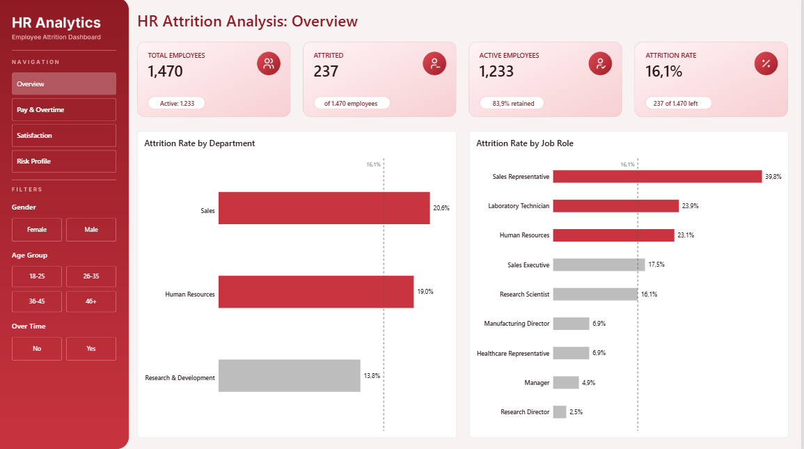
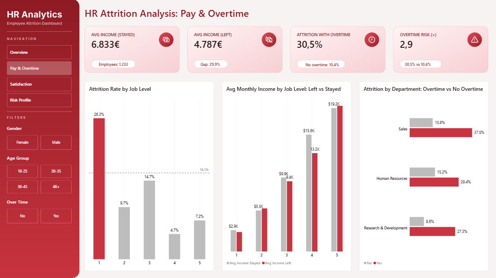
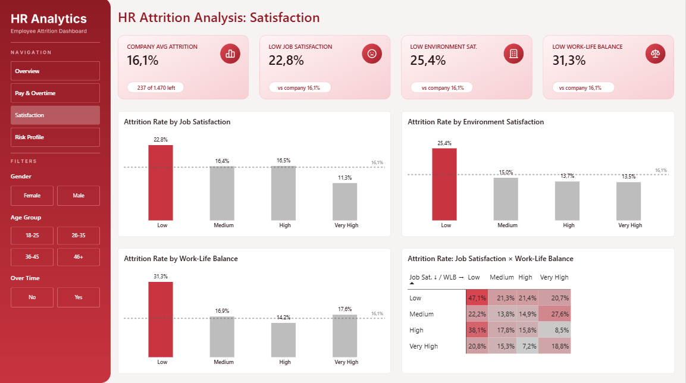
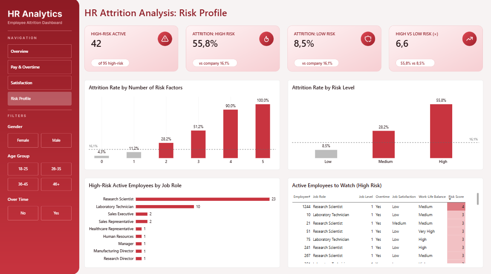

# HR Attrition Analysis | Power BI

An end-to-end Power BI project that looks at **why employees leave** and **which current employees are at risk**. Every step was built inside Power BI: data preparation in Power Query, a star-schema model, DAX measures and a 4-page interactive report.



---

## Business questions

1. What is the overall attrition rate, and how many employees left?
2. Which departments and job roles are above the company average?
3. Do employees who leave earn less than those who stay, at the same job level?
4. How much does overtime increase the risk of leaving?
5. How do job satisfaction, environment satisfaction and work-life balance relate to attrition?
6. Which combination of factors marks a high-risk employee?
7. How many **active** employees fit that high-risk profile, and where are they?

---

## Dataset

- **Source:** [IBM HR Analytics Employee Attrition & Performance](https://www.kaggle.com/datasets/pavansubhasht/ibm-hr-analytics-attrition-dataset) (Kaggle)
- **Size:** 1,470 employees × 35 columns
- **Target:** `Attrition` (Yes / No)
- The dataset is fictional. IBM data scientists created it for teaching purposes.

---

## Tools

| Step | Tool |
|---|---|
| Data cleaning and transformation | Power Query |
| Data model | Power BI (star schema) |
| Calculations | DAX (measures and calculated columns) |
| Visualization | Power BI Desktop, custom JSON theme, custom background design |

---

## Data preparation (Power Query)

**Data quality check**
- Profiled all columns on the full dataset (not just the top 1,000 rows): **0 duplicates, 0 missing values, 0 errors**.
- Fixed a UTF-8 BOM issue on import (the first column loaded as `Age`).

**Cleaning**
- Removed 3 constant columns that carry no information: `EmployeeCount` (always 1), `Over18` (always "Y"), `StandardHours` (always 80).
- Applied Trim and Clean to all text columns as a defensive step. No changes were needed.
- Set correct data types and summarization: `JobLevel` and `Risk Score` are set to *Don't summarize*.

**Transformation**
- Added `AttritionFlag` (1 / 0) for easy aggregation.
- Converted coded scales to readable labels with lookup tables and **Merge Queries**, not hard-coded replacements:
  - `LkpScale4`: 1 Low · 2 Medium · 3 High · 4 Very High → Job Satisfaction, Environment Satisfaction, Work-Life Balance
  - `LkpEducation`: 1 Below College … 5 Doctor
- Created bins: `AgeGroup` (18-25, 26-35, 36-45, 46+) and `TenureGroup` (0-2, 3-5, 6-10, 10+ years).
- Added sort-order columns so labels sort logically (Low → Very High), not alphabetically.

---

## Data model

Star schema with one fact table and two dimensions:

```
DimDepartment (1) ──► (*) HR (*) ◄── (1) DimJobRole
```

- `HR`: one row per employee (fact table)
- `DimDepartment`, `DimJobRole`: built with *Reference* queries plus *Remove Duplicates*
- `_Measures`: a dedicated table that holds all DAX measures
- Single-direction, one-to-many relationships

---

## Key DAX

```DAX
Attrition Rate = DIVIDE([Attrited], [Total Employees])

Company Attrition Rate = CALCULATE([Attrition Rate], REMOVEFILTERS())

Diff vs Company = [Attrition Rate] - [Company Attrition Rate]

OT Risk Multiplier = DIVIDE([Attrition Rate OT], [Attrition Rate No OT])
```

`Diff vs Company` drives the conditional formatting. Bars more than **2 percentage points above the company average** are shown in red, and all others in grey.

**Risk Score** (calculated column, 0–5 risk factors per employee):

```DAX
Risk Score =
    INT(HR[OverTime] = "Yes") +
    INT(HR[JobLevel] = 1) +
    INT(HR[JobSatisfaction] = 1) +
    INT(HR[EnvironmentSatisfaction] = 1) +
    INT(HR[WorkLifeBalance] = 1)
```

Risk Level: **High** (3+ factors), **Medium** (2), **Low** (0–1).

---

## Report pages

| Page | What it shows |
|---|---|
| **Overview** | KPIs, attrition by department and job role vs company average |
| **Pay & Overtime** | Attrition by job level, income of leavers vs stayers by level, overtime impact by department |
| **Satisfaction** | Attrition by job satisfaction, environment satisfaction, work-life balance, plus a satisfaction × WLB heatmap |
| **Risk Profile** | Attrition by number of risk factors and risk level, high-risk active employees by role, and a watch list for HR |

Synced slicers (Gender, Age Group, Overtime) and a page navigator sit in a sidebar on every page.

| | |
|---|---|
|  |  |
|  | |

---

## Key findings

**1. 16.1% of employees left (237 of 1,470).**
Sales (20.6%) and Human Resources (19.0%) are above average, and R&D (13.8%) is below. By role, **Sales Representatives** have by far the highest attrition at **39.8%**, followed by Laboratory Technicians (23.9%) and HR (23.1%).

**2. Attrition is concentrated at the entry level.**
Job Level 1 has **26.3%** attrition, compared with 4.7%–14.7% for levels 2–5.

**3. The pay gap mostly reflects job level.**
On average, leavers earn **$4,787** and stayers earn **$6,833**, about 30% less. At the **same job level**, though, incomes are very similar (Level 1: $2,598 vs $2,854; Level 2: $5,760 vs $5,474). People are not leaving because they are paid less than their peers. The people leaving are mostly junior employees, who earn less in general.

**4. Overtime almost triples the risk of leaving.**
Attrition is **30.5%** with overtime vs **10.4%** without (**2.9×**). This holds in **every** department: Sales 37.5% vs 13.8%, HR 29.4% vs 15.2%, R&D 27.3% vs 8.6%.

**5. "Low" satisfaction is the tipping point.**
Attrition among employees reporting *Low* job satisfaction is 22.8%, *Low* environment satisfaction 25.4%, and *Low* work-life balance **31.3%**. Above "Low", the differences are small. The worst combination (Low job satisfaction × Low WLB) reaches 47.1%, but it covers only 17 employees.

**6. Risk factors stack up.**

| Risk factors | Employees | Attrition |
|---|---|---|
| 0 | 400 | 4.3% |
| 1 | 635 | 11.2% |
| 2 | 340 | 28.2% |
| 3+ | 95 | **55.8%** |

High-risk employees leave **6.6× more often** than low-risk ones (55.8% vs 8.5%).

**7. The hidden risk is in R&D.**
**42 active employees** fit the high-risk profile. **37 of them are in R&D**, mainly Research Scientists (23) and Laboratory Technicians (10). The department with the *lowest* attrition today holds most of the future risk.

---

## Recommendations

1. **Review overtime policy.** It is the strongest single driver, and it applies in every department.
2. **Strengthen the entry level.** Set up onboarding, mentoring and a visible career path for Job Level 1, especially for Sales Representatives.
3. **Act on "Low" survey answers.** Treat a *Low* satisfaction or work-life balance response as a trigger for a manager conversation.
4. **Use the watch list.** Prioritize stay interviews with the 42 high-risk active employees, starting with R&D.

---

## Limitations

- The dataset is **fictional** and **cross-sectional** (one snapshot, no dates), so trends over time cannot be analysed.
- The Risk Score is **descriptive, not predictive**. Its factors were chosen from the same data, so it shows who *resembles* past leavers, not who *will* leave. A proper model would need a train/test split.
- Some segments are small (e.g., Low WLB = 80 employees, some heatmap cells < 30), so those percentages are indicative only.

---

## Repository structure

```
├── HR_Attrition_Analysis.pbix
├── HR-Employee-Attrition.csv
├── theme/
│   └── HR_Red_Theme.json
├── screenshots/
│   ├── overview.png
│   ├── pay_overtime.png
│   ├── satisfaction.png
│   └── risk_profile.png
└── README.md
```

---

## Author

**George Tziouvelis**
[LinkedIn](https://www.linkedin.com/in/george-tziouvelis) · [GitHub](https://github.com/tziougeo)
